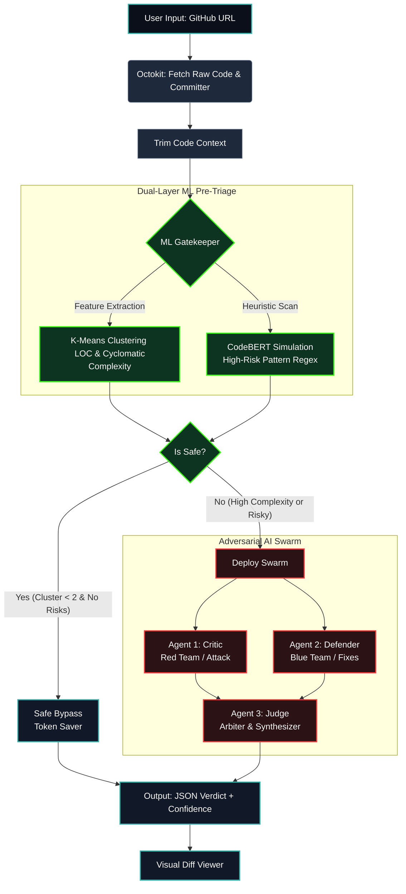

# AegisCode 🛡️

**Zero-Trust Software Auditing powered by a Generative AI Swarm and Dual-Layer ML Pre-Triage.**


## Overview

AegisCode is an enterprise-grade DevSecOps auditing platform. It leverages a multi-agent Generative AI swarm (Critic, Defender, and Judge) and a dual-layer ML pre-triage system to autonomously detect, debate, and resolve vulnerabilities, architectural bottlenecks, and logic flaws directly from a GitHub repository file. 

Designed for speed and precision, the system filters out low-risk files to conserve tokens and reduce execution time, reserving the heavy-lifting adversarial AI swarm for complex, high-risk codebases.

## System Architecture

The pipeline operates as a zero-trust funnel, starting with fast structural and heuristic analysis, and only escalating to expensive LLM reasoning when justified.



## Core Pipeline Details

1. **GitHub Context Extraction:** Safely parses GitHub URLs (blob or raw formats), fetches the raw file content via the Octokit REST API, and determines the author of the last commit.
2. **Context Trimming:** Strips comments and collapses whitespace to reduce the LLM token load by up to 30%, optimizing for speed and cost.
3. **Dual-Layer ML Pre-Triage (Gatekeeper):**
    * **Structural Analysis (K-Means Simulation):** Calculates Cyclomatic Complexity (tracking control flow operators) and Lines of Code (LOC) to categorize the file into Low, Medium, or High complexity tiers.
    * **Heuristic Scan (CodeBERT Simulation):** Scans for critical security antipatterns (e.g., `eval`, SQL injection vectors, SSRF potential, permissive CORS).
    * **Bypass:** If the code is simple and clean, the system immediately returns a safe verdict, skipping the LLM swarm entirely.
4. **Adversarial AI Swarm:** If the ML layer flags the code, three parallel agents are deployed using the `gemini-2.5-flash` model:
    * **Critic:** Aggressively hunts for security flaws, O(N) bottlenecks, and memory leaks.
    * **Defender:** Validates the Critic's claims, calls out AI hallucinations, and writes production-ready code fixes.
    * **Judge:** Weighs the debate, assigns a strict Confidence Score (0.0-1.0) and Severity Tier, and synthesizes the final optimized code. 
5. **Strict JSON Enforcement:** The Judge utilizes `responseMimeType: "application/json"` and a rigorous `responseSchema` (using `SchemaType` enums) to guarantee the frontend parser never crashes from conversational text.

## Getting Started / Local Setup

Follow these steps to run AegisCode locally.

### 1. Clone the Repository

```bash
git clone https://github.com/yourusername/aegiscode.git
cd aegiscode
```

### 2. Install Dependencies

```bash
npm install
```

### 3. Configure Environment Variables

Create a `.env.local` file in the root directory:

```bash
touch .env.local
```

Add the following keys (these are required for the application to function):

```env
# A GitHub Personal Access Token (PAT) with basic repository read permissions
GITHUB_PAT=your_github_pat_here

# Your Google Generative AI API Key (for the Gemini 2.5 Flash swarm)
GEMINI_API_KEY=your_gemini_api_key_here
```

### 4. Run the Development Server

```bash
npm run dev
```

Open [http://localhost:3000](http://localhost:3000) in your browser. Paste a GitHub file URL (e.g., `https://github.com/owner/repo/blob/main/src/index.ts`) into the terminal interface to initiate an audit.
