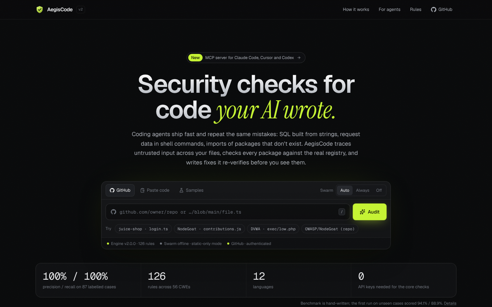
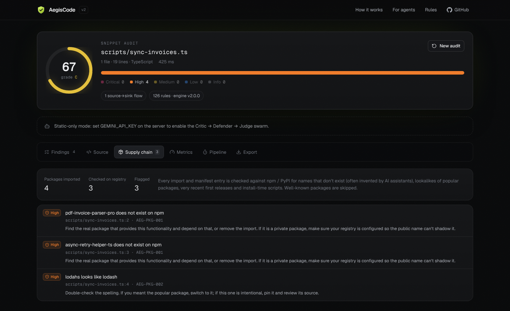
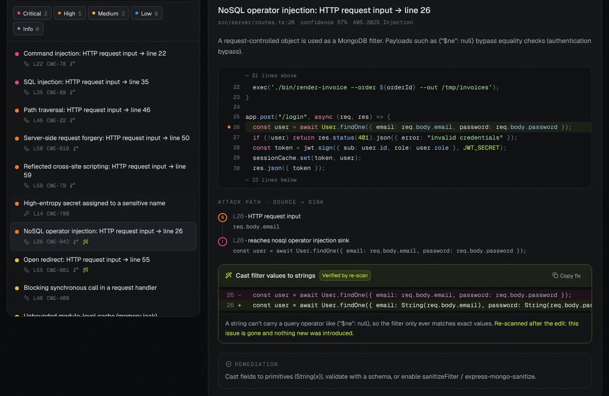
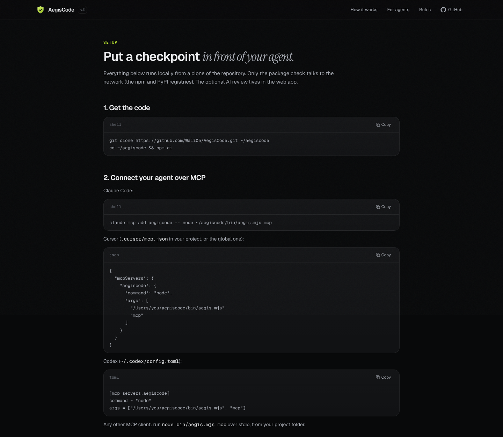
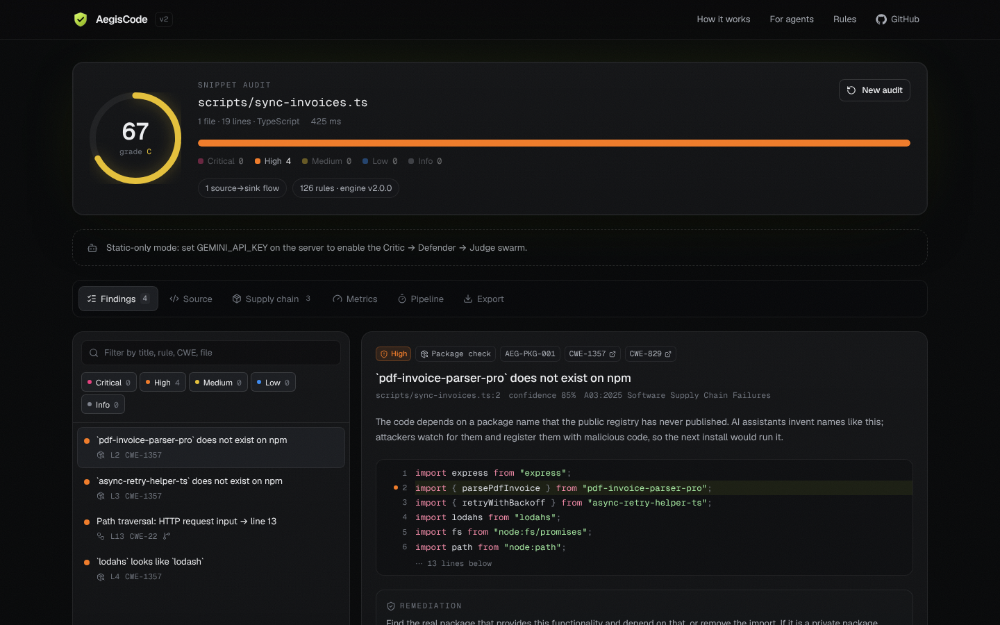
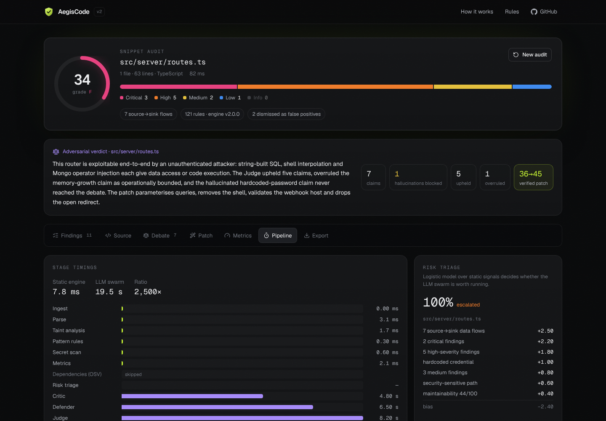
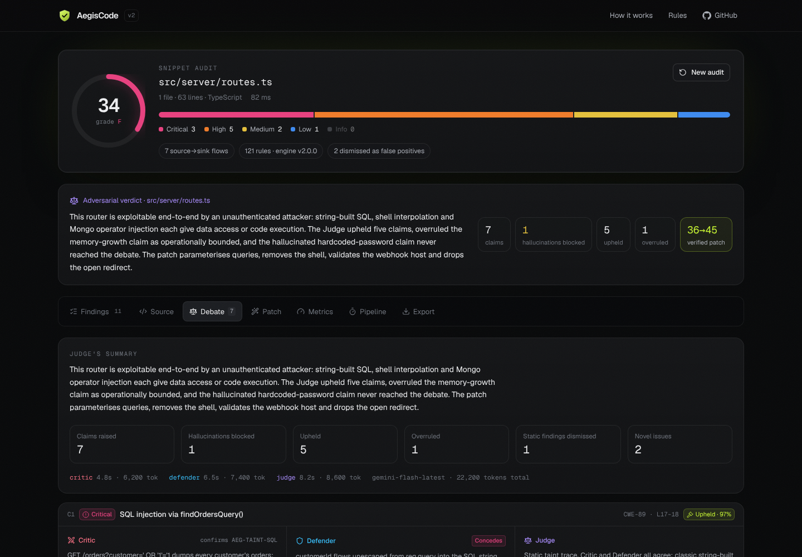
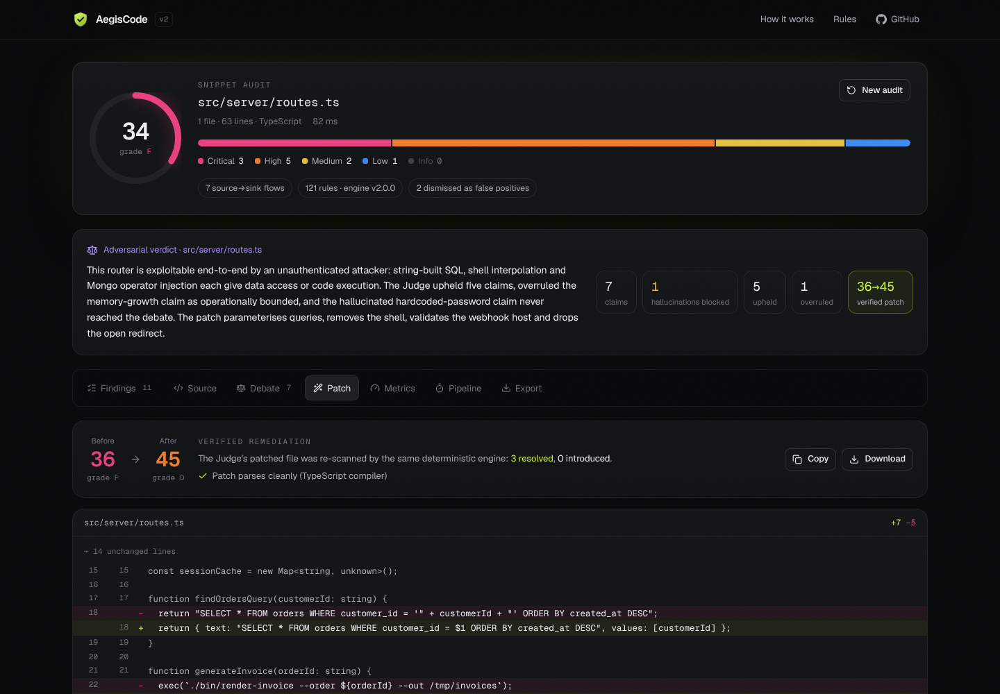

<div align="center">


# AegisCode

Security checks for code your AI wrote.

[](https://github.com/Wali05/AegisCode/actions/workflows/ci.yml)




</div>

Most of the code I write now starts life in Claude Code or Cursor. It's fast, and it's usually fine, but the mistakes these agents make are always the same few: a SQL string built with `+`, a request field dropped into `exec`, a redirect to whatever `?next=` says, and every so often an import of a package that doesn't exist. That last one is worse than it sounds. People register those made-up names on npm and wait for someone to install them (it's called slopsquatting).

AegisCode is the check I wanted between the agent and the commit. It's a static analyser that follows untrusted input across files, checks every new import against the real npm and PyPI registries, and only suggests a fix after re-scanning the patched code to confirm the issue is actually gone. It runs as an **MCP server** your agent can call, a **pre-commit hook**, a **CI step**, and a **web app** for looking at any GitHub repo.

It started as a weekend "send the file to Gemini" project. The output looked impressive until you checked it: line numbers that didn't exist, confident claims about code that wasn't there. So I rebuilt it around one rule: **anything it reports has to be something the code itself can prove.** The analyser does the work. The language model is optional, and it can only argue about findings the analyser already has evidence for.

## What it does

### Follows data across files

The analyser parses JS/TS with the TypeScript compiler and tracks values from where an attacker controls them (`req.query`, `request.json()`, `location.hash`, `process.argv`, …) to where they become dangerous (`db.query`, `exec`, `fetch`, `innerHTML`, `res.redirect`, …). It goes through variables, string building, callbacks, class fields and function calls, and it follows imports: ES modules, `require`, default exports, aliases, and barrel files that re-export from somewhere else.

```
api.ts      app.get("/s", async (req, res) => res.json(await search(req.query.q)));
service.ts  return run("SELECT * FROM docs WHERE body LIKE '%" + q + "%'");
repo.ts     return pool.query(sql);
```

```
CRITICAL SQL injection: HTTP request input (from api.ts) → line 2
         repo.ts:2  AEG-TAINT-SQL  CWE-89  conf 77%
         api.ts:2 HTTP request input → api.ts:2 passed to search() in service.ts
         → service.ts:3 concatenated into string → service.ts:3 passed to run() in repo.ts
         → L2 reaches sql injection sink
```

It also understands the checks people actually write before using input: allowlists (`ALLOWED.has(x)`), anchored regexes, `typeof` checks, equality against constants, `startsWith("/")` on paths, `isValidX()` and `validateX()` helpers, and ternaries. If the dangerous call is only reachable after one of those, it isn't reported. This removed most of the false positives I was getting from real projects.

Python and PHP use a simpler line-by-line version of the same idea. Go, Java, Ruby, C#, Rust, C/C++ and shell get pattern rules.

### Catches packages that don't exist

Every import and manifest entry that isn't a well-known package gets looked up on npm or PyPI. It flags:

| Rule | What it means |
|---|---|
| `AEG-PKG-001` | The package doesn't exist. Almost always an invented name. |
| `AEG-PKG-002` | The name is one or two edits away from a popular package (`lodahs`, `reqeusts`, `expresss`). |
| `AEG-PKG-003` | The first release was less than 30 days ago. |
| `AEG-PKG-004` | The package runs a script when it's installed. |
| `AEG-PKG-005` | The version is deprecated or yanked. |

If the registry can't be reached, those packages are listed as "not checked", not as fine. Vulnerable versions of real packages are a separate check against OSV.dev, with CVSS scores and the version that fixes each one.



### Suggests fixes, and checks them first

For the common cases there's a fix: parameterised SQL, `textContent` instead of `innerHTML`, `path.basename` for file paths, `String()` around Mongo filter values, local-only redirects, and turning TLS verification back on. Each fix is applied to a copy of the file, which is then scanned again. It's only shown as verified if the issue is gone from that line *and* nothing new appeared. The fixers are deliberately conservative: if the SQL isn't a plain query string, or the "user input" is a table name in an `ORDER BY`, there's no fix, because the honest answer there is "rewrite this".



`aegis scan --fix` applies the verified ones to your files.

### Only reports what you just added

Nobody fixes 300 old findings before their next commit, so the agent-facing modes only report issues the current change introduces. `--staged`, `--changed` and `--since main` scan the changed files plus the local files they import (so a flow that crosses into an unchanged helper still shows up), then compare against the same files before the change. Findings are matched on rule, file and the text of the line rather than the line number, so moving code around doesn't make old issues look new. For a whole-repo scan you can save a baseline once and compare against that.

### The rest

- **Secrets:** AWS, GitHub, Stripe, OpenAI, Anthropic, Slack and private keys, plus an entropy check on anything assigned to `password`, `token`, `apiKey` and similar. Values are masked before they reach a report.
- **Pattern rules:** 126 rules in total, covering disabled TLS checks, weak crypto, `pickle.loads`, `shell=True`, Flask debug mode, wildcard CORS, `gets()` and so on. Every rule maps to a CWE and to the OWASP Top 10 (2025). The full list is at `/rules` in the app.
- **Code health:** O(n²) lookups in loops, `await` in loops, caches that grow forever, React effects without cleanup, and functions too complex to review.
- **Optional AI review:** with a Gemini key, three agents go over the findings in the web app. A Critic attacks the code, a Defender argues against false positives, and a Judge rules and writes a patch. Every line the Critic quotes is checked against the real file first, and invented quotes are thrown out. The Judge's patch is re-scanned so the before/after score is measured.

## How accurate is it?

`bench/` holds 87 small hand-labelled cases: 52 vulnerable, and 35 safe ones written to look dangerous (validated input, parameterised queries, allowlisted redirects). `npm run bench` runs them and writes [bench/RESULTS.md](bench/RESULTS.md).

It currently gets all 87 right. That number flatters it, though: I wrote most of those cases while tuning the engine, so they work as a regression suite more than an independent score. To keep myself honest, I wrote 26 more cases *after* the engine was done and ran them once before changing anything. That first run scored **94.1% precision and 88.9% recall**: one false alarm and two misses. Those three are fixed now, so the held-out set passes too. Treat roughly 90% as the realistic number on code it hasn't seen. The test suite fails if either score drops below 95% on the full set.

## Using it with a coding agent

Clone it once somewhere on your machine:

```bash
git clone https://github.com/Wali05/AegisCode.git ~/aegiscode
cd ~/aegiscode && npm ci
```

Then add it as an MCP server. For Claude Code:

```bash
claude mcp add aegiscode -- node ~/aegiscode/bin/aegis.mjs mcp
```

Cursor (`.cursor/mcp.json`) and Codex (`~/.codex/config.toml`) take the same command and arguments. The [/agents](src/app/agents/page.tsx) page in the app has copy-paste config for each.



The server exposes five tools:

| Tool | What it's for |
|---|---|
| `scan_changes` | Scans staged, uncommitted or since-branch changes and returns only the new issues. This is the one to call before committing. |
| `scan_code` | Scans file contents before they're written to disk. |
| `check_packages` | Checks package names before the agent adds them. |
| `scan_paths` | Scans files or folders inside the project. |
| `explain_rule` | Explains a rule ID and how to fix it. |

Results come back as plain text written for the agent, with the data flow and the verified fix when there is one. Then add a line to your `CLAUDE.md` or `AGENTS.md` telling it to call `scan_changes` before committing and `check_packages` before adding a dependency.

Since agents don't always follow instructions, there's also a git hook:

```bash
cd your-project
node ~/aegiscode/bin/aegis.mjs hook install
```

It scans staged changes and blocks the commit if they add anything high or critical (`AEGIS_FAIL_ON=medium` makes it stricter). `git commit --no-verify` skips it once.

## CLI

```bash
node bin/aegis.mjs scan src                         # scan a folder
node bin/aegis.mjs scan --staged                    # what you're about to commit, new issues only
node bin/aegis.mjs scan --since origin/main         # everything on this branch
node bin/aegis.mjs scan . --write-baseline aegis-baseline.json
node bin/aegis.mjs scan . --baseline aegis-baseline.json --fail-on high
node bin/aegis.mjs scan src --fix                   # apply verified fixes
node bin/aegis.mjs scan src --sarif aegis.sarif     # for GitHub Code Scanning
```

It can also write `--json` and `--md`, and `--no-deps` skips everything that needs the network. In a pull request workflow, `--since origin/main --sarif aegis.sarif --fail-on high` fails the check only for issues the PR introduces, and the SARIF upload puts them inline on the diff. This repo runs the scanner on its own source in [CI](.github/workflows/ci.yml).

To silence a false positive, leave a comment with a reason:

```ts
// aegis-ignore AEG-JS-010 -- md5 is only used as a cache key here
const key = createHash("md5").update(url).digest("hex");
```

The finding still appears in reports, marked as dismissed with your reason.

## The web app

The web app is the dashboard for all of this. You can paste code, point it at a GitHub file or a whole repo, or try one of the samples (one of them is a file "written by an agent" that imports two packages that don't exist). Progress streams in live over server-sent events, so what you see is the actual pipeline running.

<table>
<tr>
<td width="50%"><br/><sub>A report on the agent-output sample: made-up packages and a path traversal.</sub></td>
<td width="50%"><br/><sub>Pipeline timings: the analyser takes milliseconds, the AI review takes seconds.</sub></td>
</tr>
<tr>
<td><br/><sub>The optional AI review (scripted model from the test suite).</sub></td>
<td><br/><sub>The Judge's patch, re-scanned (same test data).</sub></td>
</tr>
</table>

```bash
git clone https://github.com/Wali05/AegisCode.git
cd AegisCode
npm install
cp .env.example .env.local
npm run dev
```

Every environment variable is optional:

| Variable | What it does |
|---|---|
| `GEMINI_API_KEY` | Turns on the AI review. Without it you still get everything else. |
| `GEMINI_MODEL` | Defaults to `gemini-flash-latest`. |
| `GITHUB_TOKEN` | Raises GitHub's limit from 60 to 5,000 requests an hour and allows private repos (read-only is enough). |
| `MAX_REPO_FILES` | Files to scan per repo (default 40). It picks the ones most likely to matter: routes, auth, database code. |
| `RATE_LIMIT_PER_10_MIN` | Audits allowed per IP (default 12). |

## Project layout

```
src/
  lib/engine/       the analyser: lexer, taint tracking (per file and across files), rules, secrets, fixes, scoring
  lib/deps/         manifests, OSV advisories, CVSS, the npm / PyPI package check
  lib/swarm/        the optional AI review: Gemini provider, schemas, quote checking, agents
  lib/baseline.ts   "what's new" comparison
  lib/pipeline.ts   runs the stages in order and emits progress events
  cli/              the aegis command, git change scans, the MCP server
  app/              Next.js pages and the streaming audit API
  components/       the UI
bench/              labelled cases and the benchmark runner
tests/              vitest
```

## Some decisions

- **Why not just ask a model?** Models are good at judgement ("is this endpoint meant to be public?") and bad at bookkeeping ("which variable did this come from three files ago?"). A checkpoint that runs on every commit has to be fast, free, deterministic and right about line numbers, so the core is a plain analyser.
- **Fixes have to earn the word "verified".** A suggestion that compiles but doesn't remove the issue, or that introduces a new one, is worse than no suggestion. So each one is re-scanned, and a fixer refuses to run when it isn't sure.
- **"Not checked" is not "fine".** If npm is down, the report says so rather than quietly passing.
- **Scoring.** A file's score drops faster for one critical than for a pile of minor issues. An open critical caps it at 59, an open high at 79. A repo's score is a size-weighted average of its files, so big repos aren't penalised for being big.
- **The tool's own security.** It sends a strict CSP, validates every input, only fetches from GitHub, OSV and the package registries (never a URL you typed), and escapes code before rendering it.

## Limitations

- Cross-file tracking covers JS/TS. Python and PHP flows stay inside one file and use the lighter line-based analysis.
- It doesn't run your code, so anything decided at runtime (dynamic `require`, values from a database, framework magic it doesn't know about) is invisible to it.
- The guard detection covers the common patterns, not every possible validation, which is why findings carry a confidence value.
- The package check needs network access. In a locked-down environment those packages are reported as not checked.
- The benchmark is mine. It's small and I wrote it, so read the held-out number, not the headline one.
- The web app's cache and rate limiter are in memory. That's fine for one server, but more than one would need something like Redis.

## Scripts

```bash
npm run dev        # dev server
npm test           # tests
npm run check      # lint + typecheck + tests
npm run bench      # accuracy benchmark → bench/RESULTS.md
npm run build      # production build
npm run scan -- .  # CLI
```

## License

MIT
